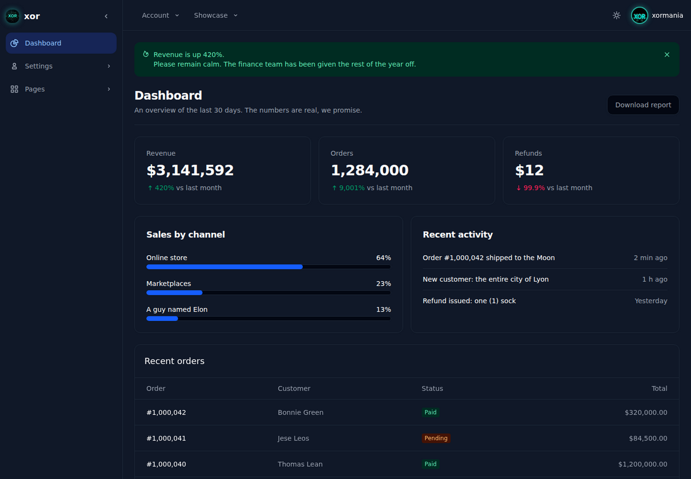

# UXor

An independently maintained Symfony UI library, currently distributed as a
[Symfony UX Toolkit](https://symfony.com/bundles/ux-toolkit/current/index.html) kit and styled with the free
[Flowbite](https://flowbite.com/) v4 library and Tailwind CSS v4: a theme, Twig components, a form theme, page layouts
and ready-made blocks such as a login card or a dashboard, each one a recipe. `php bin/console ux:install` copies a
recipe into your project, where you own it. Every behavior is a Stimulus controller, so components keep working with
Turbo and Live Components. The [Gallery](https://xormania.github.io/uxor/) shows every recipe in light and
dark, with its code.

UXor provides two deliverables for a consuming application:

- The **Toolkit kit** installs application-owned recipes through `ux:install`.
- The optional **Composer development package**, [`xormania/uxor`](packages/uxor/README.md), provides agent guidance,
  diagnostics and tools for using the kit; it installs no recipes.

The application's own instructions, workflow and permissions govern work in it. Developing either UXor deliverable
or the repository's demo and test fixtures follows the [contributor guide](https://github.com/xormania/uxor/blob/main/CONTRIBUTING.md).

The official Symfony UX `flowbite-4` kit was an initial reference only. UXor follows its own requirements and
compatibility commitments, with no requirement to track that kit's names, markup, behavior or tests. Toolkit
installation support, Flowbite CSS and the icon set are current implementation choices that can evolve with UXor.



## Install

Requires PHP 8.4 or later with the `zip` extension (the toolkit unpacks GitHub's archive of the kit).
The standard setup uses AssetMapper and TailwindBundle and runs without Node.js.
On a new project (`composer create-project symfony/skeleton`), run these once, in this order:

```bash
# 1. Allow Flex contrib recipes. Every component uses the `tailwind_classes` Twig filter, and a contrib
#    recipe enables its bundle (tales-from-a-dev/twig-tailwind-extra).
composer config extra.symfony.allow-contrib true
# 2. Twig and Twig components as regular dependencies. If they only come in with the toolkit (a dev
#    dependency), cache:clear fails with "non-existent service property_accessor".
composer require symfony/twig-bundle symfony/ux-twig-component
# 3. The toolkit, and the HTTP client it downloads the kit with.
composer require --dev symfony/ux-toolkit:^3.5 symfony/http-client
# 4. AssetMapper and StimulusBundle: the layouts load the `app` importmap entrypoint, and StimulusBundle
#    loads the recipes' controllers from assets/controllers/.
composer require symfony/asset-mapper symfony/stimulus-bundle
```

With [Symfony Docker](https://github.com/dunglas/symfony-docker), run these commands inside the container
(`docker compose exec php composer …`, `docker compose exec php bin/console …`); its PHP image has the `zip`
extension.

Then set up Tailwind CSS, Flowbite's stylesheet and the `theme` recipe as the *Tailwind CSS* and *Installation*
sections of [`INSTALL.md`](INSTALL.md) say (its *Symfony* steps are the commands above). After that, install recipes:

```bash
# <version>: a release, the latest one on https://github.com/xormania/uxor/releases unless you need an older one
php bin/console ux:install <recipe> --kit=https://github.com/xormania/uxor:<version>
```

Use an explicit tagged release by default: without a revision, `ux:install` downloads the repository's default
branch. For an explicitly requested test of unreleased work, use a full commit SHA and record it with the results.
[Choosing a revision](INSTALL.md#choosing-a-revision) covers existing installations and updates;
[`CHANGELOG.md`](https://github.com/xormania/uxor/blob/main/CHANGELOG.md) lists what each version changes.

`ux:install` also installs the recipes a recipe depends on. Run the `composer require` and `importmap:require`
commands it prints for the recipe's packages. [Installing recipes](https://github.com/xormania/uxor/blob/main/docs/GUIDE.md#installing-recipes) says more.

### Icons

The recipes show icons from the `flowbite` set of [UX Icons](https://symfony.com/bundles/ux-icons/current/index.html),
downloaded from the Iconify API the first time a page shows one. Before you deploy, save them in the project with
this command and commit them; run it again when your templates use new icons:

```bash
php bin/console ux:icons:lock
```

## Optional Composer development package

The optional development package is available on [Packagist](https://packagist.org/packages/xormania/uxor)
as `xormania/uxor` and shares the kit's release tags. It provides three
[Symfony AI Mate](https://symfony.com/doc/current/ai/components/mate.html) skills (set up, build, verify), Mate tools
and the `vendor/bin/uxor` command line to search the recipes, read their docs, inspect the project and check its
setup, with UXor's docs bundled in the package. It is a development dependency and installs no recipe:
recipes still come from `ux:install`, and stay yours. [`packages/uxor/README.md`](packages/uxor/README.md) says how to
install it and integrate its package-managed consumer guidance while preserving your application's own instructions.

## Requirements

| | |
|---|---|
| Symfony UX Toolkit | ^3.5 (blocks need 3.5) |
| PHP | ≥ 8.4 (required by the toolkit), with the `zip` extension; `intl` for `calendar` and `date-picker` in any locale but `en` |
| Symfony | 7.4 LTS and 8.1: CI installs the kit on both (8.1 in a fresh Symfony Docker project), and the demo and its browser tests run on 8.1 |
| Assets | The standard setup uses Symfony AssetMapper and StimulusBundle. `chart` needs `chart.js` in the import map (Flex adds it), and `editor` needs the Tiptap modules from the printed `importmap:require` command. `markdown-editor` needs `symfony/ux-live-component` for its preview |
| Tailwind CSS | 4.x |
| Flowbite | 4.x |

## Documentation

- [Recipes](https://github.com/xormania/uxor/blob/main/docs/RECIPES.md): every recipe, one line each, linked to its README.
- [Guide](https://github.com/xormania/uxor/blob/main/docs/GUIDE.md): installing and updating recipes, Turbo and Live Components, security, versioning.
- [`INSTALL.md`](INSTALL.md): setting up the kit in a Symfony application.
- Agent-assisted application work: [`FOR-AGENTS.md`](https://github.com/xormania/uxor/blob/main/FOR-AGENTS.md) and [`llms.txt`](https://github.com/xormania/uxor/blob/main/llms.txt).
  Kit-only applications may adapt the short optional [`project snippet`](https://github.com/xormania/uxor/blob/main/docs/PROJECT-AGENTS-SNIPPET.md);
  applications using the helper can use its package-managed guidance without duplicating it.
- [`docs/APPLICATION-TESTING.md`](https://github.com/xormania/uxor/blob/main/docs/APPLICATION-TESTING.md): verify UXor's integration in your application.
- [`CHANGELOG.md`](https://github.com/xormania/uxor/blob/main/CHANGELOG.md): what each version changes.
- Developing UXor: [`CONTRIBUTING.md`](https://github.com/xormania/uxor/blob/main/CONTRIBUTING.md) and [`AGENTS.md`](https://github.com/xormania/uxor/blob/main/AGENTS.md) govern work on the kit,
  package and repository fixtures; [`docs/TESTING.md`](https://github.com/xormania/uxor/blob/main/docs/TESTING.md) describes their tests and CI.

## License

MIT — see [`LICENSE`](LICENSE) and [`NOTICE`](NOTICE) (Symfony UX, Flowbite).
